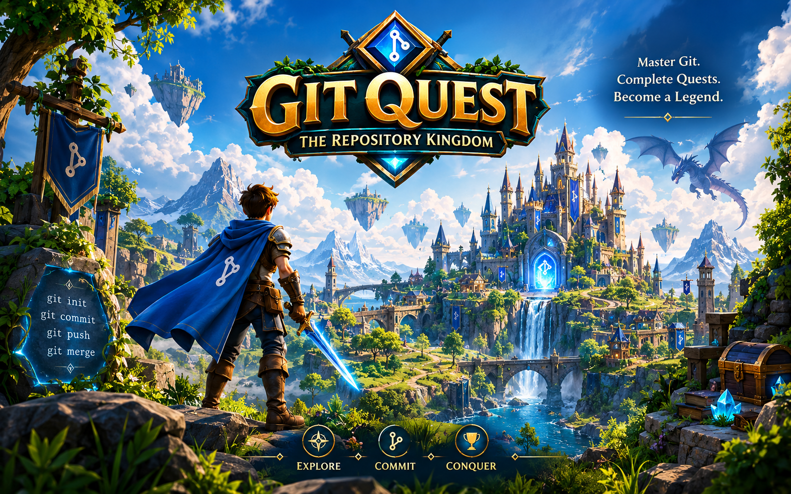

# Git Quest: The Repository Kingdom

Learn Git by playing. Explore a 3D fantasy kingdom, type real Git commands into a safe simulated terminal, defeat monsters and bosses, and rise from Apprentice to Git Legend.

Built with React, TypeScript, Three.js / React Three Fiber and Vite, and prepared for publishing on [start.ng](https://start.ng).



## Features

- **Safe Git simulator**: commands run against an in-memory repository. Nothing ever touches your real files or Git repositories.
- **8 worlds plus 4 secret missions**: from `git init` to merge conflicts, remotes, pull requests, stash, revert, reset, cherry-pick, rebase and reflog.
- **Combat tied to learning**: the right command hurts the monster, a wrong one costs HP. Failures come with a plain-English explanation. Hints are free.
- **Progression**: XP, ranks, abilities (Commit Shield, Branch Vision, Conflict Sense, Recovery Crystal), gems, achievements and a proficiency report.
- **Practice mode**: wrong commands cost no health, for relaxed learning.
- **3D exploration**: third-person hero, glowing route to each monster, bridges, jump physics and a walkable kingdom hub.
- **Procedural audio**: music and sound effects are synthesised in the browser (no audio files).
- **start.ng integration**: player sign-in, the player's own start.ng character on the 3D hero, and the shared leaderboard.

## Controls

| Action | Keys |
|---|---|
| Walk | `W` `A` `S` `D` or arrow keys (or the on-screen stick on touch) |
| Jump | `Space` |
| Zoom | Mouse wheel, `+` / `-`, or the zoom buttons |
| Type a command | Click the terminal. Movement keys are ignored while typing |
| Hints | Type `hint` (a second `hint` also shows the concept) or press the Hint button |
| Other terminal commands | `help`, `clear` (all free, no HP cost) |

## Getting started

Requirements: Node.js 18 or newer.

```bash
npm install
npm run dev        # http://localhost:5173
```

In development the game uses **mock adapters** (fake sign-in, local character editor, demo leaderboard players). These are clearly labelled in the UI and are never used in production builds.

### Scripts

| Script | What it does |
|---|---|
| `npm run dev` | Start the dev server with mock adapters |
| `npm run build` | Production build into `dist/` |
| `npm run preview` | Serve the production build locally (runs as an offline guest) |
| `npm run typecheck` | Type-check the project |
| `npm test` | Run the test suite |
| `npm run lint` | Lint the code |

To run the production adapters in development: `VITE_ADAPTER_MODE=startng npm run dev`.

## Project structure

```
app.html                      Vite source page (NOT index.html, see "Publishing")
public/                       favicon, cover.png, startng.json (leaderboard columns)
src/
  App.tsx                     screen navigation
  game/
    adapters/                 Auth, Character, Progress, Leaderboard (+ config)
    platform/startng.ts       start.ng connect-page client
    engine/                   GameEngine (progress, combat, XP) and failure explanations
    simulator/GitSimulator.ts the simulated Git
    data/                     worlds, quests, ranks, secret missions
    world3d/                  worlds, terrain, paths, creatures, signals
    hero/HeroModel.tsx        the articulated 3D hero
    components/               screens, HUD, terminal, UI pieces
    audio/                    procedural music and effects
    tests/                    unit, world and quest-solution tests
docs/                         design, architecture, start.ng and verification notes
```

How Git state reaches the 3D scene: the simulator produces a repository state, `world3d/signals.ts` turns it into world signals, and the worlds react to those signals (shrines awaken, bridges restore, routes glow). Failed commands do not change state, so they never trigger success effects.

## start.ng integration

Written from the official start.ng documentation. See [`docs/START_NG_INTEGRATION.md`](docs/START_NG_INTEGRATION.md) for the details.

- **Players**: the game asks start.ng's connect page who is playing. Signed-in players are shown by name. Everyone else plays as start.ng's guest, with a Sign in button.
- **Character**: the player's start.ng character (body, colours, hair, hat, accessory) is drawn on the 3D hero. Unknown values fall back to defaults. The character is read-only in the game.
- **Leaderboard**: columns are declared in `public/startng.json` (XP, worlds cleared, gems, secret missions). Only signed-in players' scores are saved. Guests can view the board.
- **Saves**: start.ng has no cloud save for games, so progress is saved in the browser, per player. It does not follow a player to another device.
- **Off start.ng** (localhost, preview): there is no connect page, so the game runs as an offline guest.

## Publishing on start.ng

start.ng serves a static, already-built game from a public GitHub repo. It never runs your build.

1. `npm run build`
2. Confirm `dist/` contains `index.html`, `assets/`, `startng.json` and `cover.png`.
3. Commit **`dist/`** and push to a public GitHub repo. `dist/` is intentionally not git-ignored.
4. Dry-run the platform checks:
   ```bash
   curl -X POST https://api.start.ng/games/check -H "Content-Type: application/json" \
     -d '{"repo_url":"https://github.com/<you>/<repo>","name":"git-quest"}'
   ```
5. Publish with the same body to `https://api.start.ng/games/publish`. The first time, open the returned `approve_url` and sign in to approve.
6. The game goes live at `https://git-quest.start.ng`. To update, rebuild, commit `dist/` and push.

The source page is `app.html` because start.ng refuses a source `index.html` at the top of a repo. A small plugin in `vite.config.ts` serves it at `/` in dev and renames it to `dist/index.html` on build.

## Testing and status

Checked so far (see [`docs/VERIFICATION.md`](docs/VERIFICATION.md) for the full report):

- 221 tests, including a replayed solution for all 44 quests and a simulated hero walk through all 12 maps.
- The UI was driven in headless Chromium against stand-ins for the 3D scene and start.ng.

**Not yet verified:** the real 3D rendering and frame rate, the live start.ng platform, sound, and touch controls.

## Known limitations

- The hero, monsters and worlds are procedural placeholders. A full visual redesign is still outstanding.
- Progress is stored per browser (no cloud save).
- A browser game cannot be made cheat-proof. Bad scores can be removed by the game owner through start.ng's API.
- The Gate Crasher secret mission and the World 5 boss currently require the order: push (rejected), pull, push.

## Documentation

- [`docs/DESIGN.md`](docs/DESIGN.md): design decisions and pass history
- [`docs/ARCHITECTURE.md`](docs/ARCHITECTURE.md): architecture and adapters
- [`docs/START_NG_INTEGRATION.md`](docs/START_NG_INTEGRATION.md): platform integration and publishing
- [`docs/VERIFICATION.md`](docs/VERIFICATION.md): what has and has not been verified
